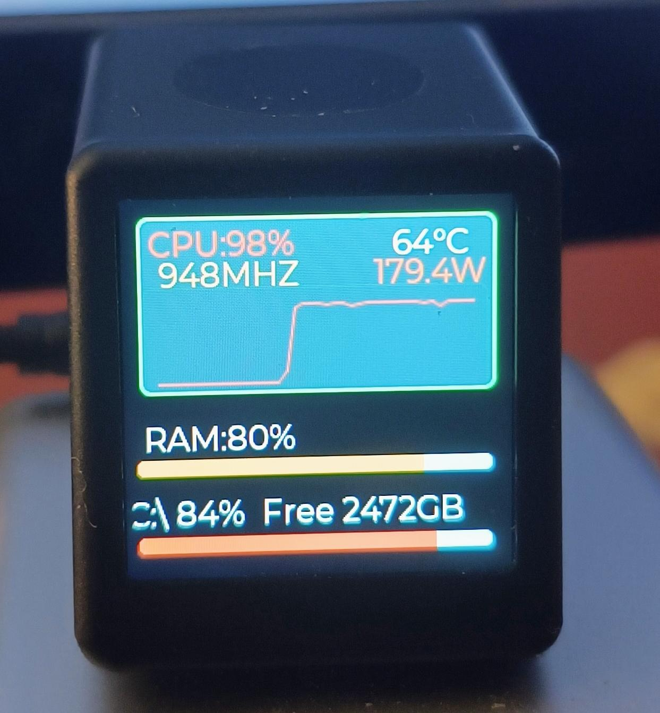

# GeekMagic Custom Monitor (AIDA64 Emulator)

This project is a lightweight Python server that streams your PC's performance metrics (including NVIDIA GPU data) to GeekMagic devices (SmallTV Pro / Hellocubic). 

It serves as a fully functional replacement for AIDA64. It consumes minimal resources, avoids wearing out the device's flash memory, and allows for highly customizable data transmission.

## 🌟 Features
* **Zero Flash Wear:** Data is streamed (via SSE) directly into the device's RAM. We do not write images to the flash memory, significantly extending the device's lifespan.
* **System Tray App:** The application runs silently in the system tray. Use the right-click context menu to manage it (Start / Stop / Exit).
* **NVIDIA GPU Support:** Streams GPU load, temperature, power consumption, and VRAM usage.
* **Universal CPU Support:** Automatically detects your CPU's maximum frequency for accurate pseudo-frequency scaling.
* **Firmware Workarounds:** Implements clever hacks to bypass the firmware's limitations for precise CPU frequency and VRAM reporting (see below).


*Example of the monitor running with a custom layout, displaying GPU data.*

## 🚀 Installation & Usage

1. Install the required dependencies:
   ```pip install psutil nvidia-ml-py pystray Pillow
   ```

2. Run the script:
   ```python GM_monitor.py```
*(The default port is `9998`. To use a custom port, run `python GM_monitor.py 8080`)*

3. In the device's web interface (Monitor app), enter the IP address of your PC (e.g., `192.168.1.100`) and the port you configured (`9998`). The device and the PC must be on the same local network.

## 🛠 GeekMagic Protocol Details (API)

The device does not use standard SSE. Its parser is extremely strict. Through reverse engineering (using Wireshark), we discovered the following rules:

### 1. HTTP Request from the Device

The device sends this request to your PC's IP address and the configured port:

GET /sse HTTP/1.1
Content-Type:application/json;charset=utf-8
Host: 192.168.1.100:9998
User-Agent:Smalltv-Pro
Connection: close

### 2. Server Response (CRITICAL)
Standard Python `http.server` does not work here because it adds unnecessary headers (`Server`, `Date`) and fragments the data. The device only accepts **a single TCP packet** containing both the headers and the payload.

**Correct Headers** (note the use of `\n` instead of the standard `\r\n`):
HTTP/1.1 200 OK\n
Content-Type: text/event-stream\n
Cache-Control: no-cache\n
Access-Control-Allow-Origin: *\n
Access-Control-Expose-Headers: *\n
Access-Control-Allow-Credentials: true\n
\n

### 3. Payload Format
Data is transmitted as a single line, separated by `{|}`. The packet must end with two newlines `\n\n`.

data: Page0|{|}Simple1|F_CPU: 1500 MHz{|}Simple2|UP_CPU: 45%{|}...{|}Simple16|UP_GPU: 45%{|}\n\n

### ⚠️ Major Pitfalls
1. **Fragmentation:** If you send the headers and the `data:` block in separate TCP packets, the device will close the connection. The script concatenates everything into one `sendall()` call.
2. **The Degree Symbol Bug:** Due to a localization bug in AIDA64, it sends `\xd0\x8e\xd0\xb6` (Cyrillic "Юж" in Latin-1 encoding) instead of the actual `℃` symbol. The device's parser is hardcoded to look for these specific bytes. The script uses `latin-1` encoding to send them "as is".
3. **Integer Rounding:** The device's firmware strictly rounds all numbers to integers.

## 💡 Implemented Hacks (What we actually send)

| ID | On-Screen Label | Actual Data Sent | Logic / Hack |
| :--- | :--- | :--- | :--- |
| Simple1 | F_CPU: | **Pseudo-Frequency (MHz)** | Windows often reports the base clock for `psutil`. We detect the CPU's max frequency and scale it based on the real CPU load (%). |
| Simple2 | UP_CPU: | GPU Load (%) | Mapped to GPU data. |
| Simple3 | S_FAN: | 0 RPM | Stub (not used). |
| Simple4 | UP_RAM: | RAM Usage (%) | Real data. |
| Simple5 | U_DRIVE_C: | **Used VRAM (in MB)** | To bypass rounding, we send megabytes (e.g., 12000). The screen will show "12000 GB" (but it's actually MB). |
| Simple6 | T_CPU: | GPU Temperature (°C) | Uses the weird Cyrillic "Юж" bytes. |
| Simple8 | UP_DRIVE_C: | VRAM Usage (%) | Real data. |
| Simple9 | T_DRIVE_C: | 0°C | Stub (not used). |
| Simple10 | FR_DRIVE_C: | **Free VRAM (in MB)** | Same as Simple5. Precision down to 1 MB. |
| Simple11 | U_RAM: | Used RAM (MB) | Real data. |
| Simple12 | TIME: | Current Time (HH:MM) | System time of the PC. |
| Simple13 | GPU1: | Used VRAM (MB) | Real data. |
| Simple14 | GPU2: | 0 MB | Stub (no secondary GPU). |
| Simple15 | PW_CPU: | GPU Power Draw (W) | Real data. |
| Simple16 | UP_GPU: | GPU Load (%) | Duplicates Simple2 (used for the graph). |

*To display correct labels on the screen (e.g., "VRAM" instead of "U_DRIVE_C"), edit the `monitor_config.txt` file on the device and change the `<LBL>` tags.*

## 📦 Compiling to EXE (No Console Window)

To create a standalone executable, use PyInstaller:

```pip install pyinstaller
pyinstaller --noconsole --onefile --icon=icon.ico --add-data "icon.ico;." GM_monitor.py
```

*(The `icon.ico` file must be in the same folder as the script. The compiled `.exe` will appear in the `dist` folder).*

## 📝 License
MIT License. Do whatever you want, just don't break your devices.
